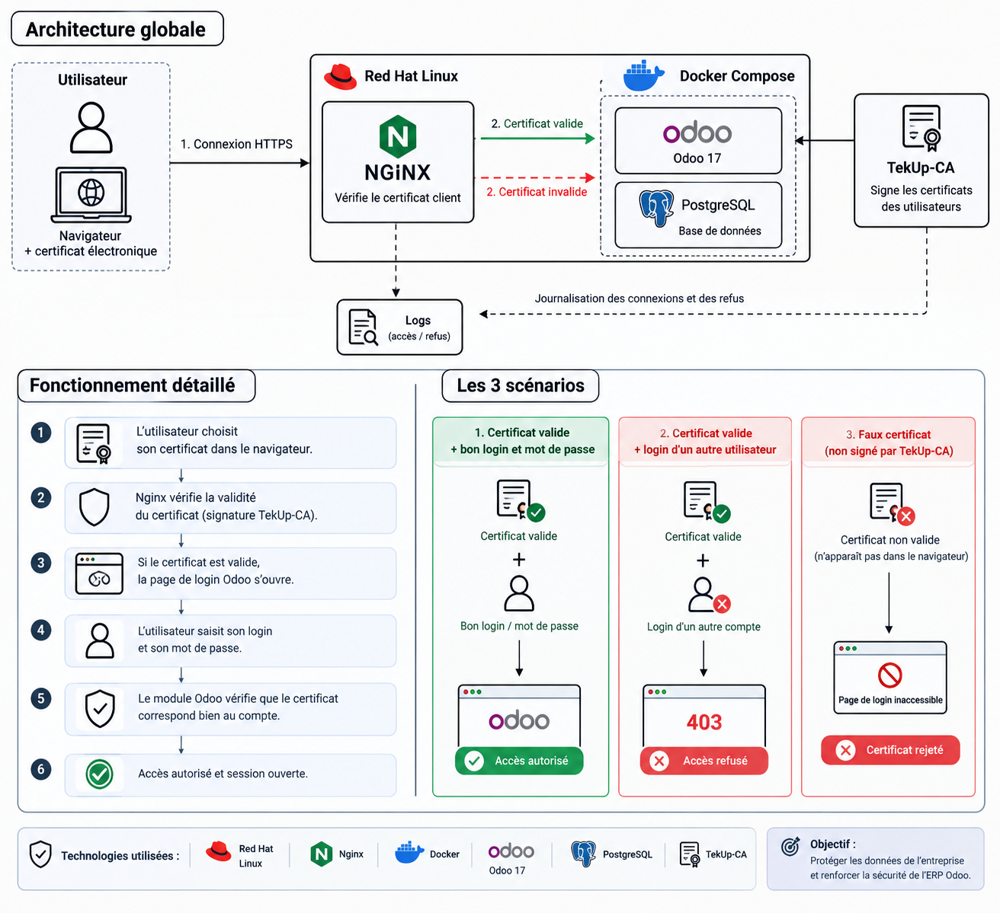
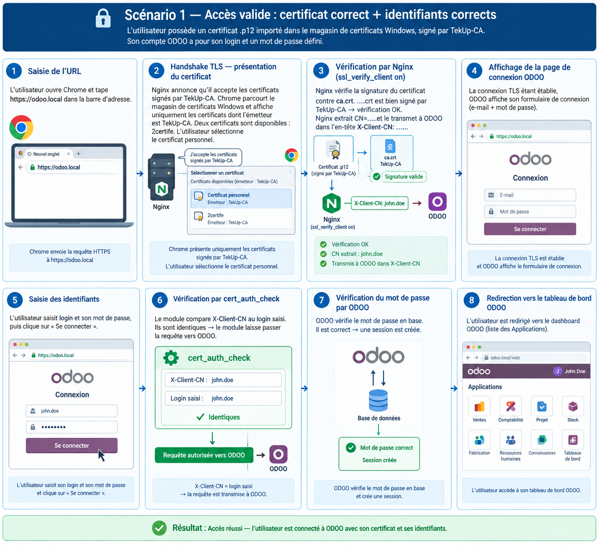

# 🔐 Authentification forte (MFA) par certificat électronique pour Odoo

Projet de sécurisation de l'ERP **Odoo 17** par une **double preuve d'identité** : un **mot de passe** et un **certificat électronique** signé par notre propre autorité de certification (**TekUp-CA**).

L'infrastructure tourne sur un **serveur Red Hat Linux durci**, avec Odoo et PostgreSQL dans **Docker Compose**, et **Nginx** comme point d'entrée qui contrôle les certificats.

---

## 📌 Sommaire

1. [Contexte et problème](#-contexte-et-problème)
2. [Solution proposée](#-solution-proposée)
3. [Pourquoi le MFA ?](#-pourquoi-le-mfa-)
4. [Architecture globale](#-architecture-globale)
5. [Fonctionnement détaillé](#-fonctionnement-détaillé)
6. [Les 3 scénarios de connexion](#-les-3-scénarios-de-connexion)
7. [Outils utilisés](#-outils-utilisés)
8. [Étapes de réalisation](#-étapes-de-réalisation)
9. [Sécurité et traçabilité](#-sécurité-et-traçabilité)
10. [Démo](#-démo)
11. [Auteures](#-auteures)

---

## ❗ Contexte et problème

Par défaut, l'accès à Odoo repose sur **un seul secret : le mot de passe**.

Si ce mot de passe est **volé** (phishing), **deviné** ou **réutilisé** depuis une autre fuite :

- l'intrus se connecte **sans aucun autre contrôle** ;
- il accède aux **données de l'entreprise** : clients, factures, stock, ressources humaines ;
- rien ne prouve que la personne connectée est la bonne.

👉 **Un mot de passe seul ne suffit pas** pour protéger un ERP.

---

## ✅ Solution proposée

Nous ajoutons une **deuxième preuve d'identité** : un **certificat électronique**, comparable à une **carte d'identité numérique installée dans le navigateur**.

| Preuve | Type | Exemple |
|---|---|---|
| 🧠 Mot de passe | Ce que je **sais** | Login + mot de passe Odoo |
| 🪪 Certificat | Ce que je **possède** | Fichier `.p12` importé dans le navigateur |

**Pour entrer dans Odoo, il faut les deux :**

> Certificat valide **+** bon login/mot de passe **=** accès autorisé

Règles appliquées :

- chaque certificat est **lié à un seul compte** Odoo ;
- un certificat **non signé par TekUp-CA** est refusé dès la connexion HTTPS ;
- un certificat valide utilisé avec **le login d'une autre personne** est refusé (erreur **403**) ;
- chaque connexion et chaque refus sont **journalisés**.

---

## 🛡️ Pourquoi le MFA ?

**MFA = Multi-Factor Authentication** : plusieurs preuves d'identité au lieu d'une seule.

**Analogie :** la carte bancaire et le code PIN. Avec un seul des deux, on ne peut rien faire.

| | Sans MFA | Avec MFA (certificat + mot de passe) |
|---|---|---|
| Nombre de preuves | 1 (mot de passe) | 2 |
| Mot de passe volé | ❌ Accès total | ✅ Accès impossible sans le certificat |
| Identité de la personne | Non prouvée | Vérifiée par le certificat |
| Traçabilité | Faible | Chaque connexion est tracée |
| Confidentialité (SMSI) | Exposée | Protégée |

---

## 🏗️ Architecture globale

**Les composants :**

| Composant | Rôle dans l'architecture |
|---|---|
| 👤 Utilisateur | Navigateur + certificat électronique installé |
| 🔴 Red Hat Linux | Serveur durci qui héberge toute la solution (`odoo.local`) |
| 🟢 Nginx | « Vigile » : active HTTPS et **vérifie le certificat client** |
| 🐳 Docker Compose | Lance Odoo et PostgreSQL dans des conteneurs isolés |
| 🟣 Odoo 17 | L'ERP à protéger, avec le module de contrôle `cert_auth_check` |
| 🐘 PostgreSQL | Base de données d'Odoo |
| 📜 TekUp-CA | Autorité de certification qui **signe** les certificats des utilisateurs |
| 📝 Logs | Journal des accès autorisés et des refus |

> 💡 **Principe clé :** tout passe par Nginx. Le certificat est vérifié **avant** que la page Odoo ne s'affiche.

---

## ⚙️ Fonctionnement détaillé

| Étape | Qui | Action |
|---|---|---|
| 1 | Utilisateur | Ouvre `https://odoo.local` et **choisit son certificat** dans le navigateur |
| 2 | Nginx | Vérifie la **signature du certificat** avec la CA TekUp-CA (`ssl_verify_client on`) |
| 3 | Nginx | Si valide : laisse passer vers Odoo et transmet le nom du certificat (**CN**) dans l'en-tête `X-Client-CN` |
| 4 | Odoo | Affiche la **page de connexion** |
| 5 | Utilisateur | Saisit son **login** et son **mot de passe** |
| 6 | Module `cert_auth_check` | **Compare** `X-Client-CN` (certificat) avec le **login saisi** |
| 7 | Odoo | Si identiques : vérifie le **mot de passe** dans la base de données |
| 8 | Odoo | Mot de passe correct : **session créée**, redirection vers le tableau de bord |

> ⚠️ En cas de différence entre le certificat et le login, le module renvoie **HTTP 403 immédiatement**, **sans consulter la base de données**.

---

## 🎬 Les 3 scénarios de connexion

| # | Certificat | Login / mot de passe | Résultat |
|---|---|---|---|
| 1 | ✅ Valide | ✅ Correct (même compte) | ✅ **Accès autorisé** |
| 2 | ✅ Valide | ❌ Login d'un autre utilisateur | ⛔ **403 Forbidden** |
| 3 | ❌ Faux (non signé par TekUp-CA) | — | ⛔ **Certificat rejeté**, page de login inaccessible |

### ✅ Scénario 1 : accès valide

L'utilisateur possède un certificat `.p12` signé par TekUp-CA, importé dans le magasin de certificats Windows. Il se connecte avec **son propre login** et **son propre mot de passe**.

**Déroulement :**

1. L'utilisateur ouvre `https://odoo.local` dans Chrome.
2. Nginx n'accepte que les certificats signés par TekUp-CA, donc Chrome ne propose que ceux-là.
3. L'utilisateur choisit son certificat personnel.
4. Nginx vérifie la signature, extrait le **CN** et le transmet à Odoo dans `X-Client-CN`.
5. Odoo affiche le formulaire de connexion.
6. L'utilisateur saisit son login et son mot de passe.
7. `cert_auth_check` compare le CN du certificat au login : **identiques**, la requête passe.
8. Odoo vérifie le mot de passe en base, crée la session et ouvre le tableau de bord.

**Résultat : accès réussi.** ✅

### ⛔ Scénario 2 : certificat valide mais login différent

L'utilisateur présente le certificat d'une personne (par exemple **nozha**) mais tente de se connecter avec le **login d'une autre personne** (par exemple **khouloud**).

Le certificat est **techniquement valide** (signé par TekUp-CA), mais il **ne correspond pas au compte visé**.

**Déroulement :**

1. L'utilisateur ouvre `https://odoo.local`.
2. Il choisit le certificat de nozha dans la boîte de dialogue.
3. Nginx vérifie la signature : **OK**, et envoie le CN du certificat à Odoo.
4. Odoo affiche la page de connexion.
5. L'utilisateur saisit un **autre login** et le mot de passe correspondant.
6. `cert_auth_check` compare le CN du certificat et le login saisi : **ils diffèrent**.
7. Le module renvoie **HTTP 403** sans consulter la base de données.
8. Chrome affiche la page **403 Forbidden**.

**Résultat : accès refusé.** Le certificat est valide, mais il ne correspond pas au compte demandé. ⛔

> 🔒 **Intérêt :** même si un utilisateur connaît le mot de passe d'un collègue, il ne peut pas l'utiliser avec **son propre certificat**.

### 🚫 Scénario 3 : faux certificat

Un certificat **non signé par TekUp-CA** n'apparaît même pas dans la liste du navigateur. Si la connexion est forcée, Nginx le rejette : la **page de login n'est jamais accessible**.

**Résultat : certificat rejeté.** ⛔

---

## 🛠️ Outils utilisés

### Infrastructure

| Outil | Rôle |
|---|---|
| **Red Hat Linux** | Système du serveur, durci : pare-feu, SELinux, SSH protégé |
| **Docker / Docker Compose** | Lance Odoo et sa base de données dans des conteneurs isolés |
| **Odoo 17** | L'ERP : le logiciel de gestion à protéger |
| **PostgreSQL** | Stocke toutes les données d'Odoo |

### Sécurité

| Outil | Rôle |
|---|---|
| **Nginx** | Active le HTTPS et **exige le certificat de l'utilisateur** |
| **OpenSSL + TekUp-CA** | Créent et **signent** les certificats de notre autorité |
| **Module `cert_auth_check`** | Compare le **nom du certificat** (CN) au **login** saisi |

---

## 🧩 Étapes de réalisation

| Phase | Description |
|---|---|
| 1. Serveur | Installation et durcissement de Red Hat Linux (pare-feu, SELinux, SSH) |
| 2. Conteneurs | Déploiement d'Odoo 17 et PostgreSQL avec Docker Compose |
| 3. Autorité de certification | Création de la CA **TekUp-CA** avec OpenSSL |
| 4. Certificats clients | Génération et signature d'un certificat par utilisateur, export en `.p12` |
| 5. Nginx | Configuration HTTPS + vérification du certificat client (`ssl_verify_client on`) |
| 6. Module Odoo | Installation de `cert_auth_check` pour comparer certificat et login |
| 7. Tests | Validation des 3 scénarios (accès valide, login incompatible, faux certificat) |

---

## 📊 Sécurité et traçabilité

- 🔐 **Double authentification** : certificat + mot de passe
- 🪪 **Un certificat = un compte** Odoo
- 🧱 **Aucun accès direct à Odoo** : tout passe par Nginx
- 📝 **Journalisation** de chaque connexion et de chaque refus
- 🛡️ **Serveur durci** (pare-feu, SELinux, SSH protégé)
- 🔒 Les **clés privées** et fichiers `.p12` ne sont **jamais publiés** dans ce dépôt

**Objectif :** protéger les données de l'entreprise et renforcer la sécurité de l'ERP Odoo (confidentialité, dans une démarche SMSI).

---

## 🎥 Démo

👉 [Voir la vidéo de démonstration sur LinkedIn](COLLE_TON_LIEN_ICI)

---

## 👩‍💻 Auteures

- **Bahri Khouloud**
- **Rebhi Aya**

📚 Projet réalisé à **TEK-UP University**.
